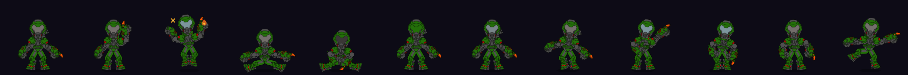

# HyprTV

Tema tipo [Hyprland](https://hyprland.org/) para una Smart TV Android (probado en una KTC 2K con Google TV, Android 14, 32 bits y 1,5 GB de RAM), sin root:

- **Launcher** con "espacios" (`apps`, `media`, `sistema`), mosaicos con huecos y esquinas redondeadas, al estilo de una barra waybar.
- **Borde de foco** global (servicio de accesibilidad) que se dibuja sobre cualquier app.
- **Mascota**: el **Doom Slayer**, que comenta lo que hay en pantalla con sarcasmo, baila cuando la TV lleva un rato sin usarse y se esconde mientras suena audio. Está hecho con sprites dibujados a mano y animados por un esqueleto.
- **Atajos del mando** para apagar el tema o la mascota.



## Privacidad y diseño

- **Sin permisos de Internet** (ni ningún otro): lo que se lee de la pantalla nunca sale de la TV.
- El servicio de accesibilidad solo escucha cambios de ventana y de foco.
- Consume 0 % de CPU en reposo: la mascota solo anima tras un evento.
- Sin dependencias en el APK (nada de AndroidX ni Compose): ~1,6 MB. El núcleo es Rust (`core/`, dibujo con tiny-skia) y la interfaz Kotlin.

## Compilar

Windows, con Android Studio (JBR), el NDK 27.2, `cargo-ndk` y Rust con los targets `armv7-linux-androideabi` y `aarch64-linux-android`.
Los comandos, la estructura del código y las decisiones de diseño están en **[AGENTS.md](AGENTS.md)**.

```powershell
.\scripts\test-rust.ps1     # pruebas y clippy del núcleo
.\scripts\deploy.ps1        # compila e instala en la TV conectada por ADB
```

Se usa bajo tu propia responsabilidad: instalar un launcher y un servicio de accesibilidad en una TV cambia su comportamiento. `restaurar_tv.ps1` la devuelve al launcher de Google TV.

## Licencia

[MIT](LICENSE): el código y los dibujos del autor se pueden usar, copiar y modificar libremente.

## Aviso sobre el Doom Slayer

Es un proyecto de aficionado, sin relación con id Software ni Bethesda. *Doom* y *Doom Slayer* son marcas de sus propietarios, y la licencia MIT no concede ningún derecho sobre ellas. Los sprites de `core/assets/sprites_png` son dibujos propios del autor inspirados en el personaje.
